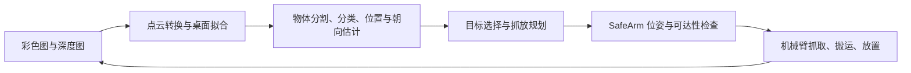

# PiPER 视觉抓取与分拣

面向松灵高校具身智能交流赛的视觉操作项目，使用 PiPER 六轴机械臂、平行夹爪和 RGB-D 相机完成方块抓取、果蔬分拣及自然语言指令任务。主要代码位于 [`ws/src/cube_task`](ws/src/cube_task)。

同一套感知、抓取规划和任务控制代码支持运动学仿真、MuJoCo 物理仿真、图像回放和真机运行。真机通过 **pyAgxArm + CAN** 控制机械臂，通过 **ROS 2 图像话题**获取相机数据；运行 `cube_task` 不需要同时启动官方机械臂控制节点。

| 任务 | 内容 | 限时 | 当前方案 |
|---|---|---|---|
| L1 精准抓取 | 3 个彩色方块抓取并放到指定区域 | 180 秒 | 深度分割 + HSV 颜色分类 |
| L2 视觉分拣 | 6 个果蔬模型分类、抓取和投放 | 300 秒 | 深度分割 + KNN；可选 YOLO ONNX |

比赛现场统一提供 PiPER、大白深度相机和物料，计算设备由参赛队自备。类别表、区域映射、接口及相机安装方式以正式技术附件为准。本队只参加 L1 / L2，不参加大模型（VLA）探索赛。

## 当前状态（2026-11-12）

分支 `motion`。以下只写已经验证过的内容，现场前以 [赛前收尾 TODO](schedule/赛前收尾TODO.md) 为准。

| 项目 | 状态 |
|---|---|
| 运控（`motion_ctl` + MoveIt/RViz 拖动） | 仿真验证通过；**实机未测**（本机没有 CAN 适配器和大白相机）。见 [运控使用说明](ws/src/cube_task/docs/运控使用说明.md) |
| L1 仿真（eye_in_hand，normal） | 红、绿、黄 3/3 放对；hard 难度的贴靠方块定位仍有失败用例 |
| L2 仿真 | **暂不能稳定生成场景**：1000×500 mm 桌面的临时布局下，手腕相机只看得到取物区约 ±0.18 m，6 个物体排不下；弯曲物体（黄瓜、香蕉）的抓取点偏差导致 `grasp_miss`。临时布局 A 的取物区和黄卡纸重叠 1 cm、和绿/红卡纸间隙 0，黄卡纸伸到 x = 0.59 m；按赛方给的实际摆法重调时一并改 |
| 全量测试 | 47 个失败、1030 通过、106 跳过（11/12，已合并 main；main 上是 51 个失败）。失败集中在官方 L2 场景生成（P0-2 未完成）和依赖它的端到端测试；`test_can_up_missing_interface_mentions_the_official_script` 只在没初始化 `third_party` 子模块时失败 |
| 默认夹爪宽度 | `robot.gripper.max_width` 已改为 0.100 m（行程 100 mm） |
| 已按官方文档定下 | 只有 1 台腕端大白（`camera.mount: eye_in_hand`）；内参读 `camera_info`，手眼外参自己用 `calib_points` 标（不提供标定文件）；L1 方块 50 mm、红/绿/黄；3 张 200 × 200 mm 卡纸；物体须完全进入卡纸，黄瓜投影 ≥ 2/3；机械臂经 USB 转 CAN 直连，上电前确认 J1 零点刻度线对齐 |
| 待现场确认 | TCP 长度（配置 0.140 m，手册 0.1425 m，两处要同步改）、夹爪力单位、相机话题名、取物区与卡纸位置 |

仿真只验证流程，不代表真实相机和物料上的识别精度；颜色标定、外参标定和 KNN 训练必须在现场做。

## 工作流程



待抓物体的位置由视觉估计；放置区域的位置、相机标定参数和类别到区域的对应关系由配置提供。MuJoCo 相机渲染彩色图和深度图，并加入噪声、深度缺失；场景真值用于渲染、物理计算及评分，不直接作为任务控制器的抓取坐标。

只支持腕端相机（`eye_in_hand`，比赛唯一的相机）：每次放置后回观察位取图，L2 可以示教多个观察视角。固定相机的代码和仿真已删除，固定相机的标定文件会被拒绝。整轮结束后默认停在最后动作结束的位置。

## 仓库结构

```text
vision/
├── third_party/pyAgxArm/          官方 Python SDK，Git 子模块
└── ws/
    └── src/
        ├── agx_arm_ros/           官方 ROS 2 驱动、描述与 MoveIt，Git 子模块
        ├── handeye_calibration_ros/  官方手眼标定工具，Git 子模块
        └── cube_task/             本项目的任务包
            ├── cube_task/
            │   ├── camera/       ROS 相机、文件回放、深度对齐
            │   ├── perception/   分割、分类、几何估计、抓放规划
            │   ├── robot/        真机接口、运动学、SafeArm
            │   ├── sim/          RGB-D 渲染、场景、MuJoCo 仿真
            │   ├── task/         任务循环、抓放技能、指令解析
            │   ├── tools/        命令行入口
            │   └── core/         配置、坐标变换、时钟和日志
            ├── config/           默认值、现场模板与现场配置
            ├── models/           KNN / ONNX 模型及标签
            ├── scripts/          CAN、真机启动与 MuJoCo 启动脚本
            ├── docs/             操作和开发文档
            └── test/             pytest 测试
```

## 环境准备

基础环境为 **Ubuntu 22.04、Python 3.10**，真机相机使用 **ROS 2 Humble**。当前运行基线为 NumPy 1.21.5、OpenCV 4.5.4；MuJoCo 已使用 3.3.0 验证。纯运动学仿真不需要 ROS、机械臂或相机。

### 获取代码和子模块

以下示例将仓库放在 `~/vision`；已有本地仓库时，直接在现有目录执行子模块初始化即可。

```bash
git clone --recurse-submodules https://github.com/Oner-Z/agileX.git ~/vision
cd ~/vision
git submodule update --init --recursive
```

`agx_arm_ros` 内还包含 URDF 子模块，因此需要 `--recursive`。它会检出仓库记录的提交，无需使用 `--remote`。

### 基础依赖

```bash
sudo apt update
sudo apt install -y python3-pip python3-venv python3-numpy \
  python3-opencv python3-yaml python3-scipy python3-pytest
```

在 Ubuntu 22.04 上优先使用系统提供的 NumPy / OpenCV。MuJoCo、SDK 或训练依赖安装在独立虚拟环境中，避免升级 ROS 使用的 NumPy。

## 先跑一轮仿真

后续命令除特别注明外，均在包根目录执行：

```bash
cd ~/vision/ws/src/cube_task

# L1：腕端相机，3 个彩色方块
python3 -m cube_task run_task --task L1 --mode sim --seed 0

# L2：腕端相机，6 个果蔬模型，3 个观察视角
python3 -m cube_task run_task --task L2 --mode sim --seed 3
```

成功时打印 `COMPLETE`、`placed 3/3` 或 `placed 6/6`，以及 `ground truth`。仿真使用虚拟时钟，报告中的任务用时是仿真时间。首次运行默认 KNN 分类的 L2 时，会训练并缓存仿真分类器。

### 四种运行模式

| 模式 | 机械臂 / 相机 | 用途 |
|---|---|---|
| `sim` | 运动学仿真臂 / 光线投射 RGB-D 相机 | 快速验证完整任务逻辑 |
| `mujoco` | MuJoCo 动力学机械臂 / 渲染 RGB-D 相机 | 验证接触、夹取、掉落，支持窗口和视频 |
| `replay` | 运动学仿真臂 / 已录制 RGB-D 数据 | 离线检查感知和规划 |
| `real` | pyAgxArm / ROS 2 相机话题 | 真机运行，也是命令的默认模式 |

`sim`、`mujoco` 默认使用生成的场景配置，忽略 `config/site/`；需要合并现场文件时加 `--site`。`mujoco` 模式用于 `run_task`；批量物理仿真使用 `sim_bench --backend mujoco`。

## MuJoCo 物理仿真

### 安装仿真环境

```bash
sudo apt install -y libgl1 libegl1 libglfw3
/usr/bin/python3 -m venv --system-site-packages ~/.venvs/piper-mujoco
env -u PYTHONPATH ~/.venvs/piper-mujoco/bin/python -m pip install \
  'numpy==1.21.5' 'mujoco==3.3.0' imageio-ffmpeg pytest
```

`--system-site-packages` 复用前面安装的 OpenCV、NumPy 和 PyYAML。启动脚本默认调用这个虚拟环境，也支持用 `MUJOCO_PYTHON` 指定其他 Python。

### 准备 PiPER 模型

模型来自 [MuJoCo Menagerie 的 agilex_piper](https://github.com/google-deepmind/mujoco_menagerie/tree/main/agilex_piper)，未随本仓库分发。首次联网下载后可离线使用：

```bash
git clone --depth 1 --filter=blob:none --sparse \
  https://github.com/google-deepmind/mujoco_menagerie.git ~/mujoco_menagerie
git -C ~/mujoco_menagerie sparse-checkout set agilex_piper
mkdir -p ~/.cache/cube_task/mujoco
cp -a ~/mujoco_menagerie/agilex_piper ~/.cache/cube_task/mujoco/
```

默认目录应包含 `~/.cache/cube_task/mujoco/agilex_piper/piper.xml` 和 `assets/`。模型放在其他目录时，给下面的运行命令增加 `--set sim.mujoco.assets_dir=/实际路径/agilex_piper`。程序会在该目录生成场景 XML，因此目录需要可写。

### 打开窗口、录制视频

```bash
cd ~/vision/ws/src/cube_task

# 桌面窗口：自动抓取，不需要手动拖动机械臂
bash scripts/mujoco_run.sh run_task --task L1 --mode mujoco --seed 0 --viewer

# L2 分拣
bash scripts/mujoco_run.sh run_task --task L2 --mode mujoco --seed 0 --viewer

# 无窗口录制 MP4，2 倍播放速度
bash scripts/mujoco_run.sh run_task --task L1 --mode mujoco --seed 0 \
  --video ~/vision_runs/videos/L1_s0.mp4 --video-speed 2
```

有桌面并传入 `--viewer` 时，脚本默认使用 GLFW；其他情况下默认使用 EGL。已设置的 `MUJOCO_GL` 会被保留。窗口运行可显式指定 `MUJOCO_GL=glfw`，无窗口可指定 `MUJOCO_GL=egl`。

## 真机接入

### 安装 SDK 和 ROS 接口

以下步骤假设已经安装 ROS 2 Humble。SDK 使用单独虚拟环境，继承系统 ROS Python 包：

```bash
sudo apt install -y can-utils iproute2 ethtool \
  python3-colcon-common-extensions ros-humble-cv-bridge \
  ros-humble-sensor-msgs ros-humble-message-filters ros-humble-visualization-msgs

/usr/bin/python3 -m venv --system-site-packages ~/.venvs/piper-runtime
~/.venvs/piper-runtime/bin/python -m pip install ~/vision/third_party/pyAgxArm

source /opt/ros/humble/setup.bash
source ~/.venvs/piper-runtime/bin/activate
cd ~/vision/ws/src/cube_task
```

使用 `python3 -m cube_task` 可直接运行源码。需要 ROS 命令入口时，可另行构建任务包：

```bash
cd ~/vision/ws
source /opt/ros/humble/setup.bash
colcon build --symlink-install --packages-select cube_task
source install/setup.bash
cd src/cube_task
```

`ros2 run cube_task <工具>` 使用构建时的 Python 解释器，依赖必须安装在该解释器可见的环境中；使用 SDK 虚拟环境时优先从激活环境执行 `python3 -m cube_task`。构建请保留 `--symlink-install`，确保源码中的现场配置和模型可被读取。

### 配置相机和现场参数

使用组委会提供的相机驱动和启动命令；自行练习用 D435i 时也通过 ROS 2 话题接入。仓库不包含 Orbbec 或 RealSense 相机驱动。确认彩色图、深度图和内参话题，并在 [`config/site/`](ws/src/cube_task/config/site/README.md) 填入实际参数。

| 文件 | 内容 | 来源 |
|---|---|---|
| `local.yaml` | CAN 口、速度、TCP、夹爪行程、相机话题与安装方式 | 参考 `config/examples/local.example.yaml` |
| `tasks.yaml` | 目标类别、类别到放置区域的映射 | 参考 `config/examples/tasks.example.yaml` |
| `poses.yaml` | 观察位、区域位置、取物范围、桌面高度 | `teach_poses` 示教 |
| `colors.yaml` | L1 方块的 HSV 区间 | `color_calib` |
| `extrinsics.yaml` | 相机外参，方向与安装方式必须一致 | 官方标定文件，或标定工具 |

模板中的数值仅供填写参考。深度须与彩色对齐，或配置有效的深度到彩色变换；16 位毫米深度转换为米时 `depth_scale=0.001`。真实的内参、外参、TCP 和区域坐标必须经过核对，不能直接使用仿真参数。

真机配置覆盖顺序为 `default.yaml → tasks.yaml → poses.yaml → colors.yaml → local.yaml → --config → --set`。`extrinsics.yaml` 由 `camera.extrinsics_file` 单独读取。

### 检查、空跑、抓取

下面的空跑和正式抓取命令会使机械臂运动。按[现场流程](ws/src/cube_task/docs/现场流程.md)完成示教和外参悬停核对，并确保只有一个程序控制 CAN 上的机械臂。

```bash
cd ~/vision/ws/src/cube_task

# CAN 配置只在没有程序控制机械臂时执行
bash scripts/can_up.sh can0 1000000
python3 -m cube_task check_setup --task L1 --live

# 先看识别，再空跑；--dry-run 会运动，但不闭合夹爪抓取
python3 -m cube_task view --task L1
python3 -m cube_task run_task --task L1 --dry-run --speed 20

# 正式抓取：脚本先检查 CAN 和环境，再启动任务
bash scripts/start.sh L1
bash scripts/start.sh L2
```

程序默认在第一次运动前请求确认，到达观察位后等待 Enter 开始计时。运行终端按 `p` 或空格停止并保持位置，按 `e` 请求电子急停，`Ctrl+C` 停止并保存日志。故障后停止，不自动重启。

## 常用参数与工具

以下示例在仿真中运行：

```bash
# 更换摆放，使用较难场景
python3 -m cube_task run_task --task L1 --mode sim --seed 5 --difficulty hard

# 仅抓指定标签，并调整本轮目标数
python3 -m cube_task run_task --task L1 --mode sim --targets red,blue \
  --set tasks.L1.required=2

# 恢复每次回观察位，并在整轮结束后回位
python3 -m cube_task run_task --task L1 --mode sim \
  --set runner.return_to_observe_after_pick=true --set runner.return_home_at_end=true

# 测试外参偏差：平移 3 mm、旋转 0.5 度
python3 -m cube_task run_task --task L1 --mode sim --extrinsics-error 0.003 0.5
```

| 工具 | 用途 |
|---|---|
| `check_setup` | 检查模块、CAN、ROS、配置；`--live` 读取设备 |
| `view` / `capture` | 感知预览 / 录制 RGB-D 数据 |
| `teach_poses` | 示教观察位、放置区域、取物范围 |
| `calib_verify` / `calib_points` | 悬停核对外参 / 重新估计外参 |
| `color_calib` / `teach_classes` | 标定 HSV / 采集样本并训练 KNN |
| `run_task` | 执行一轮任务 |
| `motion_ctl` | 运控调试：`status`、`pick`（按坐标抓）、`vision`（按视觉目标抓）、`gripper`、`moveit`（接 MoveIt/RViz 拖动） |
| `sim_bench` | 批量仿真、故障注入及结果统计 |

工具参数用 `python3 -m cube_task <工具> -h` 查看；YOLO 训练和 ONNX 部署见 [YOLO 文档](ws/src/cube_task/docs/yolo.md)。训练环境与 ROS 运行环境分开，模型及依赖在比赛前完成离线验证。

## 测试与批量评估

```bash
cd ~/vision/ws/src/cube_task

# 常规测试；未安装 MuJoCo 或缺少模型时，对应测试会跳过
python3 -m pytest -q -p no:cacheprovider test/

# MuJoCo 测试，使用专用解释器和无窗口渲染
env -u PYTHONPATH MUJOCO_GL=egl ~/.venvs/piper-mujoco/bin/python -m pytest -q \
  test/test_mujoco_scene.py test/test_mujoco_arm.py test/test_mujoco_integration.py

# 运动学批量评估
python3 -m cube_task sim_bench --tasks L1,L2 --seeds 0-9 --jobs 4

# MuJoCo 批量评估：保留每轮日志
bash scripts/mujoco_run.sh sim_bench --backend mujoco --tasks L1,L2 \
  --seeds 0-2 --save-logs
```

评估时查看 `correct / wrong / remaining`、完成时间及成功率；MuJoCo 还会统计 `dropped`。`sim_bench` 的退出码 0 表示没有放错或程序异常，仍可能有未完成的轮次，需要同时查看成功率。

## 日志与文件

默认日志目录为 `~/vision_runs`，可用 `--log-dir` 修改。

| 文件或目录 | 内容 |
|---|---|
| `<时间>_<任务>/config.yaml` | 本轮合并后的完整配置 |
| `events.jsonl` | 识别结果、决策、动作阶段与失败原因 |
| `obs_*.jpg` | 目标框、分类、分割和拒绝原因的叠加图 |
| `report.json` / `summary.json` | 任务报告 / 命令行、退出码及仿真真值 |
| `physics.json` | MuJoCo 物理事件、最终状态及失败分析 |
| `~/vision_runs/sim_site/` | 仿真工具生成的现场配置 |
| `~/.cache/cube_task/` | 仿真 KNN 缓存和默认 MuJoCo 模型目录 |

`run_task` 退出码：`0` 完成，`1` 未完成，`2` 启动前拒绝，`3` 故障，`130` 手动中断。ONNX / PyTorch 权重和录制数据受 `.gitignore` 排除，需单独备份；仿真分类器也不能直接视为真实物料上已验证的模型。

## 常见问题

| 现象 | 处理方法 |
|---|---|
| `No OpenGL_accelerate module loaded` | PyOpenGL 的可选加速模块提示，本身不会阻止仿真；继续查看后面的实际错误 |
| 窗口打开但没有抓取 | 查看是否已被 `Ctrl+C` 中断，以及日志是否反复出现 `no frame`；有桌面时用 `MUJOCO_GL=glfw bash scripts/mujoco_run.sh ... --viewer` 排查 |
| `no MuJoCo python` | 脚本默认找 `~/.venvs/piper-mujoco/bin/python`；虚拟环境在别处时设置 `MUJOCO_PYTHON=<虚拟环境>/bin/python` |
| RViz 报 `rviz_config does not exist` | 用 `scripts/moveit_rviz.sh` 启动，不要单独 `ros2 launch moveit_rviz.launch.py` |
| 缺少 `piper.xml` 或网格文件 | 下载完整 `agilex_piper` 目录，确认 `piper.xml` 与 `assets/` 都在，或设置 `sim.mujoco.assets_dir` |
| 相机 `no frame` / `stale frame` | 检查驱动、话题名、`ROS_DOMAIN_ID`、时间戳和深度对齐；D435i 练习优先使用 USB 3 接口及线材 |
| 真实 L2 提示缺少 KNN 模型 | 用 `teach_classes` 录制真实样本并训练，或配置已准备好的 ONNX 模型 |
| 改了源码配置但运行未生效 | 从包根目录启动源码，或使用 `--symlink-install` 重建；也可设置 `CUBE_TASK_ROOT=~/vision/ws/src/cube_task` |
| 某个物体一直不抓 | 查看 `decision` 事件的 `skip` / `blacklist` 原因，以及 `obs_*.jpg` 的分类和几何结果 |

## 详细文档

- [任务包说明](ws/src/cube_task/README.md)：模块结构、工具入口和输出目录。
- [运控使用说明](ws/src/cube_task/docs/运控使用说明.md)：视觉目标抓取、MoveIt/RViz 拖动控制、实机上电顺序、现场参数。
- [现场流程](ws/src/cube_task/docs/现场流程.md)：接线、自检、示教、标定核对、空跑与比赛操作。
- [配置说明](ws/src/cube_task/docs/配置说明.md)：配置项、现场文件和外参格式。
- [仿真与测试](ws/src/cube_task/docs/仿真与测试.md)：批量评估、故障注入、回放和日志分析。
- [YOLO 训练与部署](ws/src/cube_task/docs/yolo.md)：数据准备、训练、导出和推理检查。
- [需求分析](ws/src/cube_task/docs/需求分析.md)：赛题约束与设计取舍。
- [开发接口约定](ws/src/cube_task/docs/CONTRACTS.md)：坐标系、数据类型及模块接口。
- [官方 SDK](third_party/pyAgxArm/README.md)、[官方 ROS 驱动](ws/src/agx_arm_ros/README.md)、[手眼标定工具](ws/src/handeye_calibration_ros/readme_cn.md)：子模块各自的使用说明与许可信息。
